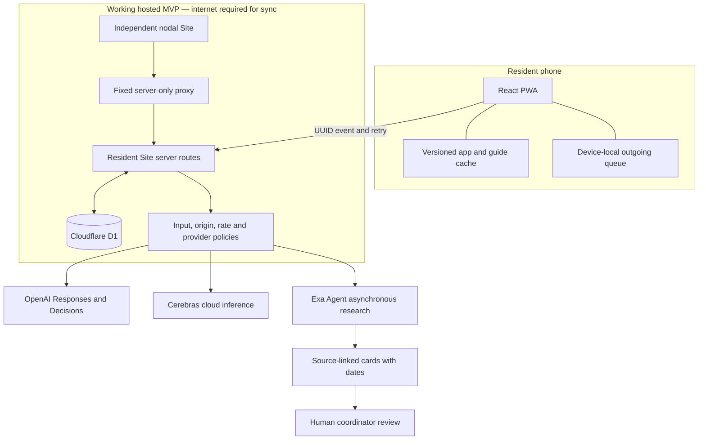
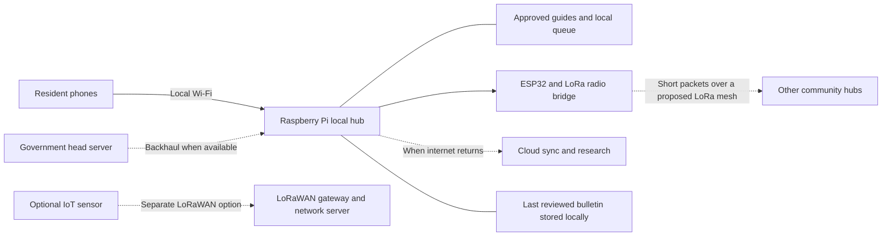

<p align="center">
  
</p>

# Together

**A little connection. A lot of hope.**

Together helps a resident say **“I need help,” “I’m safe,” or “Here is what our community needs”** and gives a coordinator a shared place to acknowledge and follow up. It combines a mobile-first Progressive Web App (PWA), saved knowledge, multilingual assistance, and a nodal relief dashboard with an interactive vision of community Wi-Fi, Raspberry Pi hubs, and LoRa communication.

Built by **Team Sisyphus** for **DevDay Exchange New Delhi**, using **Codex and ChatGPT Sites**, with live **OpenAI, Cerebras, and Exa AI** integrations.

[Explore the demo](https://together-demo.shiiim.chatgpt.site) · [Resident PWA](https://together-relief.shiiim.chatgpt.site) · [Nodal console](https://together-node.shiiim.chatgpt.site) · [Source repository](https://github.com/shhhivam12/openai-devday-delhi)

> **Prototype status — 1 November 2026:** the three hosted experiences work together through a shared cloud database. Physical radios, disconnected inter-site delivery, local AI, and field deployment are a roadmap. The Sites previews are currently private; reviewers need appropriate access. This is an exercise environment and does not contact emergency responders.


## What a reviewer can verify today

| Capability | Working in this MVP | Next deployment milestone |
| --- | --- | --- |
| Resident-to-coordinator workflow | Help requests, check-ins and community messages persist in shared Cloudflare D1; the independent nodal Site reads and updates the same records | Authenticated operator roles, auditability, retention policy and field drills |
| Request progress | `received → acknowledged → assigned → completed`, with UUID-based retries and forward-only transitions | Verified responder handoffs and district operating procedures |
| Offline PWA | After preparation: cached app, six authored guides, original illustrated local map and device-local outgoing queue | Browser/device coverage testing, durable local hub services and reviewed content distribution |
| Cloud AI | OpenAI Responses and Decisions, Cerebras `gpt-oss-120b`, and Exa Agent verified live | Measured quality, latency, cost and language evaluations |
| Language access | Hindi primary actions and English; limited Nepali strings; Garhwali, Kumaoni and Kangri preview choices | Native-speaker review and complete regional language packs |
| Community network explanation | Three.js village, interactive IoT bench and qualitative LoRa reach simulation | Real Raspberry Pi/ESP32/radio assembly, transport adapter and measured RF/power tests |
| Offline knowledge hub | Small saved information pack and source links | Kiwix/ZIM content on a physical community hotspot |

The engineering evidence is the shared workflow, offline preparation and live provider calls. The hardware scenes explain the intended system; they do not establish radio range, electrical correctness or flood prediction.

## Why this problem matters

When floods separate a family, the immediate information needs are concrete: **Who has checked in? What is needed? Where was the request recorded? Has anyone acknowledged it?** A coordinator also needs to distinguish a new request from a retry, a sourced document from a rumor, and an assignment from a completed response.

This motivation is grounded in dated reporting:

- **9 October 2026:** a UN Geneva update from UNICEF and IFRC reported **nearly 5,300 people still missing** after Nepal’s late-August flooding disaster. It described isolated communities receiving airlifted relief and roads and communications still being restored. This is an **October report about an August disaster**, not a claim that the flood began in October. [UN Geneva, UNICEF/IFRC update](https://www.unognewsroom.org/story/en/3294/nepal-disaster-update-unicef-ifrc)
- **1 September 2026:** UNDP dated the flash flood to **26 August** and described damaged energy infrastructure and communities struggling to reconnect with essential services. These observations motivate preparedness for disrupted power and communications. [UNDP Nepal assessment](https://www.undp.org/nepal/press-releases/nepal-floods-hit-vulnerable-communities-undp-estimates-22-million-tonnes-debris)
- **4 October 2024:** UNICEF’s report on the **27–28 September 2024 Nepal floods** estimated **over 80,000 people affected and 50,000 displaced**. This earlier event also informs the project’s Kathmandu-inspired demonstration. Counts are the reporting agency’s estimates at the stated date, not live figures. [UNICEF situation report No. 2](https://www.unicef.org/media/163096/file/Nepal-Humanitarian-SitRep-Floods-04-October-2024.pdf)

Together’s hypothesis is that **prepared local information, a clear request-and-acknowledgement loop, and accountable human coordination can reduce information gaps during disruption**. That hypothesis still needs field evaluation. We do not claim that this prototype found missing people, saved lives, reached affected communities or improved response times.

The community purpose shapes the product: residents should use it free, a volunteer should be able to help someone without technical knowledge, and language or unstable connectivity should not erase a drafted request. Check-ins are self-reports; they are not a verified missing-person registry or proof that a relative received a message.

## Three connected experiences

| Experience | Intended user | What to try |
| --- | --- | --- |
| [Demo landing](https://together-demo.shiiim.chatgpt.site) | Reviewers, district teams, community partners | Explore a home, a relief hub, the electronics bench and the LoRa explanation |
| [Resident PWA](https://together-relief.shiiim.chatgpt.site) | A resident or volunteer on a phone | Request help, record a safe check-in, post a community message, prepare guides and inspect the local map |
| [Nodal console](https://together-node.shiiim.chatgpt.site) | A coordinator on a laptop | Review the shared queue, acknowledge a request, advance its status and prepare a sourced district briefing |

The independent Sites have separate hosting identities. The nodal server uses a fixed, server-only proxy to the resident Site’s backend. Credentials stay on the server; both experiences use the same D1 records.

<table>
  <tr>
    <td width="34%"></td>
    <td width="66%"></td>
  </tr>
  <tr>
    <td><em>Resident: a small number of clear actions.</em></td>
    <td><em>Coordinator: a shared queue and visible acknowledgement.</em></td>
  </tr>
</table>

### A five-minute demonstration

1. **Meet the community.** Open the landing and select a cottage. The forested Himalayan village has **24 selectable fictional families and four distant hubs**, with wooded hills, terraces, small homes and animated connections. Follow the government head-server backbone, send a simulated bulletin, then disable the backhaul link to inspect the retained last bulletin. The people, locations, links and broadcasts are illustrative.
2. **Inspect the proposed node.** Open the IoT bench and select a colored jumper wire or pin. Identify the Raspberry Pi, ESP32, SX127x radio, breadboard and antenna. Switch to “LoRa in action”: follow a short help request and its acknowledgement in **Community mesh**, push a simulated **Government bulletin**, or inspect the separate **LoRaWAN sensors** gateway path.
3. **Send a real exercise record.** Open the PWA and nodal console at the same hub, such as School. Submit a fictional four-person drinking-water request. It should appear in the laptop queue.
4. **Close the loop.** Acknowledge the request on the laptop and watch the phone refresh. Continue to assigned/completed to inspect the lifecycle. A database acknowledgement is not a promise of rescue.
5. **Inspect AI provenance.** Ask a brief question using OpenAI or Cerebras. Open AI workspace in the nodal centre, research with Exa, select findings and generate a Cerebras draft. Open the source links and check issue/retrieval dates and pending review status.
6. **Demonstrate the offline boundary.** Prepare the app and guides while connected. Disconnect the device or make the origin unavailable, reload, read a saved guide, inspect the map and draft a request. Restore connectivity and use the outgoing queue’s sync control. Offline drafts should remain visibly unsent until delivery succeeds.

Use fictional names and needs throughout. No physical radio is needed to review the web MVP. Each 3D view has a **Full screen** control, with **Scene**, **Controls** and **Exit** navigation. Escape exits the expanded view. Scene state stays mounted across fullscreen entry/exit; browsers without native fullscreen use an expanded-page fallback.

## PWA: prepare once, keep useful information nearby

The resident experience uses a web manifest, app icons, a versioned service-worker cache and `localStorage` for preferences, recent activity and pending outgoing events. The preparation state is tied to the cache version so an older download does not claim a new pack is ready. API routes are excluded from the service-worker cache.

Installation uses the browser’s native install prompt when `beforeinstallprompt` is available. Otherwise, the app presents iPhone/browser instructions. Installation support depends on the browser; opening the web app remains an option.

| Situation | Available behavior |
| --- | --- |
| Internet available | Shared requests, check-ins, messages, cloud AI and online district research |
| No internet and no Wi-Fi, **after preparation** | Saved app/guides/map and storing outgoing requests on that device |
| Internet restored | Explicit retry/sync of queued events using the same UUIDs |
| Local Wi-Fi only, in today’s hosted demo | Cached content remains available; reaching the cloud backend still requires an internet path |
| Future physical community hub | Phones could reach locally hosted content and services over local Wi-Fi; compact messages could cross a radio bridge |

**“Offline” does not mean that an ordinary phone can transmit to LoRa without hardware.** Device-local storage is also not a guaranteed backup: clearing browser data or losing the phone can lose unsent records. The current app does not promise background delivery while closed.

The illustrated neighbourhood map is an original local asset with selectable hubs and fictional homes. It needs no external map tiles or GPS permission and is not navigation or safe-route guidance. The knowledge library contains **six short Together-authored guides and source links**, including a small flood explainer; it is not a complete Wikipedia download. A future “internet-in-a-box” style hub could distribute larger Kiwix/ZIM libraries over community Wi-Fi, following the approach documented by [Kiwix Hotspots](https://get.kiwix.org/en/solutions/hotspots/).

<table>
  <tr>
    <td width="60%"></td>
    <td width="40%"></td>
  </tr>
  <tr>
    <td><em>A saved, fictional neighbourhood map.</em></td>
    <td><em>Install and prepare while connected.</em></td>
  </tr>
</table>

## Architecture and data flow


[Editable full-size SVG](public/diagrams/system-architecture.svg) · [Download PNG](public/diagrams/system-architecture.png) · [Technical notes and primary sources](docs/diagrams/README.md)



### The shared network is implemented

- **Persistence:** `network_requests`, `network_checkins`, `network_messages` and `network_operations` tables, with indexed node/time access. Hub IDs are `school`, `riverside`, `health` and `hill`.
- **Retry behavior:** the client creates UUIDs before transmission; operation records support idempotent retries. A failed send remains in the phone’s outbox instead of becoming a fictional received record.
- **State transitions:** requests advance from received to acknowledged, assigned and completed; transitions cannot go backwards.
- **Separate clients:** the console polls every five seconds and the resident view every six seconds. This is shared polling, not a radio connection or a claimed real-time push network.
- **Bounded requests:** network messages are limited to 800 characters, names to 60, locations to 120 and people counts to 1–99. Shared JSON helpers cap request bodies at 16 KiB.
- **Honest failures:** unavailable D1 returns a service error and disconnected state. Empty exercise rooms remain empty. The console’s planning quantities are illustrative local values, not a shared inventory ledger.

See [network architecture and API](docs/network.md), [database schema](db/schema.ts), [network route](app/api/network/route.ts) and [policy tests](tests/server-policy.test.mjs).

### Main technologies

| Layer | Implementation | Why it is useful here |
| --- | --- | --- |
| Application | Next.js 16 application structure, React 19, TypeScript | Shared typed components for resident, coordinator and demo experiences |
| Build/runtime | Vinext/Vite, Cloudflare Workers, ChatGPT Sites | Three independently hosted web experiences with server-side integrations |
| Shared data | Cloudflare D1, Drizzle schema/migrations | Durable exercise records across independent browser sessions |
| Device continuity | Service worker, Cache Storage, `localStorage` | Prepared information and recoverable outgoing attempts on a phone |
| Interaction | Three.js | Inspectable village, IoT hardware concept and radio explanation |
| Assistance | OpenAI Responses and Decisions; Cerebras Chat Completions | Short language assistance and routing suggestions with clear provenance |
| Research | Exa Agent, structured output, grounding checks | Dated source cards for a coordinator to review |

## Exa AI and Cerebras: accelerating useful work

The integrations address two different delays: **assembling trustworthy context** and **turning context into a short, understandable answer**. They are live cloud integrations in this build. They do not provide off-grid inference or establish current field conditions.

### Exa AI: prepare a source-linked district briefing

A coordinator should not have to repeatedly search disconnected agency websites while maintaining a relief queue. Together uses **Exa Agent** to assemble a small district readiness pack for Nepal, Uttarakhand or Himachal Pradesh.

The implemented flow in [`app/api/briefing/route.ts`](app/api/briefing/route.ts) is:

1. Start a research run with fixed `effort: "low"` and a structured card schema.
2. Restrict the research request to selected government or humanitarian domains, including relevant weather/disaster authorities and UNICEF.
3. Ask for document issue dates, explicit identification of historical material, and a citation for each finding.
4. Handle the asynchronous run with a pending state and signed polling ticket. The ticket is HMAC-SHA256 signed, region-bound and expires after 30 minutes; it is not an API credential.
5. Accept only HTTPS source URLs on the approved domain list that also appear in the returned grounding citations. Exclude unsupported cards.
6. Return each accepted card with a title, summary, source URL, issue date when known, retrieval timestamp and **`reviewStatus: "pending"`**.

Completed briefings are cached for one hour within the server isolate; that cache is an optimization, not durable district-pack storage. The interface keeps saved reference material available while research runs. Exa documents Agent as an asynchronous research API; it is not treated as an instant warning feed. [Exa Agent documentation](https://exa.ai/docs/agent/quickstart)

**Verified:** a hosted run completed with **three supported official-source cards**. **Proposed benefit:** less manual source gathering and easier inspection of provenance. Research time saved and factual accuracy have not yet been benchmarked.

A future physical deployment could let an authorized coordinator approve and publish a dated pack to local hubs during connectivity windows. That approval-and-distribution pipeline is a next step; the current `pending` label must not be interpreted as approval. Exa findings never become official warnings merely because the source domain is official.

### Cerebras: short cloud answers during connectivity windows

Together’s assistance route can call **Cerebras Inference** with **OpenAI’s open-weight `gpt-oss-120b` model**. The current integration uses the OpenAI-compatible `/v1/chat/completions` endpoint, a bounded completion, and low reasoning effort. The UI identifies the selected provider and whether the result is live or a saved demonstration answer. [Cerebras OpenAI compatibility](https://inference-docs.cerebras.ai/resources/openai)

The intended benefit is responsive assistance when a resident or volunteer has a working connection: clarify the details needed in a help request, explain supplied information in plain language, and keep the answer short enough to use on a phone. The integration has returned a readable live answer with HTTP 200. **We have not measured a latency improvement or tokens-per-second result**, and no on-device Cerebras service is running.

### The coordinator AI workspace: Exa evidence → Cerebras drafts

The nodal portal now connects these services in one visual workspace, available from **AI workspace** in the sidebar, the header and the overview card. This is intended for a connected coordinator, while residents may be using cached essentials elsewhere.

1. **Research with Exa.** Choose Nepal, Uttarakhand or Himachal and select Readiness guides or Issued bulletins. A deliberate button starts a bounded asynchronous Agent run; opening the workspace makes no research call. Source cards preserve summaries, issue/retrieval dates and links, and remain pending human review.
2. **Choose the evidence.** Check or uncheck individual findings. The server signs the actual accepted research excerpts in a one-hour HMAC-SHA256 pack. The drafting endpoint checks the signature, expiry and selected indexes before calling Cerebras. This protects the integrity of the context passed from research to drafting; it does not establish factual correctness or official approval.
3. **Draft with Cerebras.** Click Summarise sources, Draft a Hindi update or What needs checking?, or ask a follow-up question in chat. Cerebras receives only the selected signed excerpts, bounded conversation history and aggregate exercise counts. The task asks for numbered source references and preserves uncertainty and document dates. The UI exposes the exact sources supplied to each answer; model citation accuracy still requires review.
4. **Prepare a handover.** This action works independently of research: the server formats recorded aggregate open-request, check-in and message counts, while Cerebras drafts neutral follow-up questions. A zero count never establishes absence of people, staff or need. Category breakdowns describe loaded records and may be a subset of the open total. Personal names, message bodies and precise resident locations are not automatically added to the AI context.
5. **Keep the human in charge.** Save a draft as text, or move a Hindi draft into the community composer. Moving it does not send it. The coordinator edits, checks sources and explicitly sends a short update through the existing exercise-room workflow. The composer shows an 800-character limit; longer drafts must be shortened. No model action dispatches help or publishes an official warning.

The assistant uses Cerebras cloud inference with OpenAI `gpt-oss-120b`, low reasoning effort and a bounded completion. Its response time is shown per call, not as a comparative speed claim. Provider failures leave the question available for retry. Research runs can be left waiting without blocking the requests board. Both services require internet; no local LLM or physical radio integration is implied.

The future milestone is authorized approval and distribution of reviewed, versioned content to physical local nodes. The current research-pack signature binds drafting context; it is not a government signature, approval workflow or implemented offline content-distribution system.

### OpenAI: assistance and accountable routing

- **Responses API:** `gpt-6-luna` produces bounded assistance using supplied context, with `store: false`. The prompt prohibits invented alerts, emergency numbers, available shelters, safe routes and rescue confirmations.
- **Decisions API:** a resource-category choice and an attention predicate suggest how to route a report. Deterministic SOS handling keeps an explicit SOS urgent independently of model output. A person remains responsible for reviewing and acting on requests.
- **Live evidence:** Responses and Decisions returned HTTP 200. One demonstration water request was categorized as `water` with confidence `0.8`; that is one smoke-test result, not a quality benchmark.
- **Optional adapter:** a transcription API route exists, but resident microphone interaction has not been verified and is not presented as a completed accessibility feature.

The project uses Codex for implementation, debugging and validation and ChatGPT Sites for the three hosted experiences. The runtime AI is called through server routes. Details and configuration are in [integrations](docs/integrations.md).

### Common provider controls

Live calls require both server-side credentials and `TOGETHER_LIVE_AI=true`. Without activation, routes return labeled saved examples and make no external AI call. Input/output bounds, same-origin checks, provider timeouts, fixed provider URLs and sanitized failures help keep the demo predictable.

Best-effort per-client limits apply within each server isolate. They are **not** a durable global quota or hard billing cap. Public deployment needs persistent limits, usage accounting and provider spending controls. No key belongs in browser JavaScript, source control, screenshots or a URL.

## IoT deployment vision: community Wi-Fi plus compact radio messages


A future node could sit at a designated school, health centre, panchayat building or shelter. The goal is a local service people can reach even when the wider internet is unavailable, backed by a compact transport for messages between sites.


The village also illustrates a proposed **government head server → internet backhaul → community hub → local distribution** path. Its bulletin control animates a demonstration broadcast; disabling backhaul leaves the last received demo bulletin visible. Bulletins are retained only while this scene is mounted; leaving the view or reloading resets them. This is simulation state, not a government API integration, a shared D1 write or delivery of an official warning. The hosted resident/coordinator workflow remains separate.

In a physical deployment, hubs could store the last approved bulletin for local access during an internet outage. Before that behavior is operational, each bulletin needs a verified origin, issue and expiry times, a verifiable signature and a human approval process. Cached notices must retain their dates and visibly indicate when they are stale; an unavailable backhaul must never make an old bulletin appear current. These verification and distribution mechanisms are future requirements.



**Dashed links are proposed physical integrations.** Neither diagram implies that the hosted server can directly access a radio or a visitor’s laptop.

| Part | Proposed responsibility | MVP status |
| --- | --- | --- |
| Raspberry Pi | Local web service, content store and site queue | Interactive 3D representation; no physical hub service deployed |
| ESP32 | Embedded interface between a local service and radio hardware | Concept shown; firmware/transport integration remains future work |
| SX127x LoRa radio and antenna | Carry compact inter-site packets | Visual model and qualitative explanation; no tested RF link |
| Local Wi-Fi | Let ordinary phones reach nearby rich content and forms | Deployment concept; hosted MVP uses the device’s existing network |
| Backup power and enclosure | Keep a field node operating safely | Bill of materials, weather protection and endurance tests still required |
| Optional sensors | Future measured environmental telemetry | No live sensor measurements or flood prediction |


The electronics scene includes a green Raspberry Pi, teal ESP32, blue radio board, white breadboard, antenna, metallic ports, colored jumper wires and selectable pin explanations. LED/power controls are educational interactions. **This is not validated wiring, a schematic or an electrical simulator.** Hardware selection, voltage compatibility, antenna placement, regional radio requirements, power design and field testing must precede deployment.

### What would run inside a physical nodal centre?

The proposed node combines **local coordination, an offline knowledge library, retrieval over reviewed documents, and optional small-model/voice services**. The core forms, queue and library should remain usable if AI is slow or unavailable. This is a reference configuration for a future prototype, not an installed system or a validated bill of materials. The current MVP continues to use hosted APIs; no local model is running on the development Mac or a Raspberry Pi.

| Proposed component | Purpose and sizing boundary |
| --- | --- |
| **Raspberry Pi 5, 16 GB RAM** | Headroom for local web services, document search and experiments with optional inference. An 8 GB knowledge-and-coordination variant could omit generation; neither configuration has been load-tested for Together. |
| **256 GB SSD with a compatible adapter** | Local database, selected ZIM archives, reviewed packs, indexes and optional model files. Choose the actual library before confirming capacity and reserve space for updates and backups. |
| **Active cooler and suitable power supply** | Support sustained operation; cooling and power requirements must be tested with the enclosure and attached devices. |
| **Local Wi-Fi access point** | Give phones and a coordinator laptop access to the node without internet. Coverage and client capacity require an on-site survey and tests. |
| **ESP32/SX127x bridge and appropriate antenna** | Future compact radio transport, separate from the Pi’s web/content service. Firmware, packet protocol and hardware compatibility remain to be implemented. |
| **Real-time clock with backup battery** | Preserve time through power interruptions so document dates and event ordering remain meaningful. Check clock accuracy during readiness drills. |
| **Backup power and protective enclosure** | Plan for controlled shutdown, recovery and the local environment. Battery endurance and weather resistance are unmeasured. |

Raspberry Pi documents the Pi 5’s 16 GB option, SSD connectivity, real-time clock and active-cooling accessories. Those capabilities inform the proposed configuration; they do not establish Together’s performance on it. [Raspberry Pi 5 specifications](https://www.raspberrypi.com/products/raspberry-pi-5/)

**Core local services.** The Pi would host the resident PWA, nodal desk and a local API. A local SQLite database would store requests, check-ins, community messages, acknowledgements and a durable store-and-forward queue. Requests should keep stable IDs as they cross a radio or internet link, with explicit queued/received/acknowledged states and retry/deduplication rules. The current cloud D1 schema is a useful starting point; synchronization between local SQLite and D1 is future work. Operator authentication, scoped roles and audit records belong in this local service too.

**Offline knowledge.** A Kiwix server could serve selected Wikipedia ZIM archives alongside approved preparedness guides and saved local maps. Select language, topic and archive size deliberately rather than assuming all Wikipedia will fit or is useful. Kiwix provides different archive variants, including versions without images. Reviewed official guidance should take precedence over general encyclopedia material for operational questions. Static archives cannot establish a current warning, an open shelter or a safe route. [Kiwix FAQ](https://get.kiwix.org/en/faq/)

**Retrieval first; generation optional.** The proposed retrieval-augmented generation (RAG) path would be:

1. **Prepare before deployment:** curate approved documents, preserve source/issue/expiry metadata, split them into passages and build a SQLite full-text search index. An optional vector index could use [`multilingual-e5-small`](https://huggingface.co/intfloat/multilingual-e5-small); document embeddings would be prepared with the content pack, avoiding expensive re-indexing during an outage.
2. **Retrieve locally:** search keywords first, and optionally embed the resident’s query locally for semantic retrieval. Select roughly **three to five relevant passages**, applying source authority, language and freshness filters. If evidence is missing or expired, show that limitation and offer source browsing or coordinator review.
3. **Answer from evidence:** an optional small model receives the question and only the selected short context. The interface should show source titles, issue dates and pack version beside the answer and keep the original passage available. Generation must not invent current conditions from a static pack.
4. **Keep essential services responsive:** use a serial AI job queue, bounded context/output and a clear wait/cancel state. Forms, acknowledgements and direct document search should not depend on a model response.

One example candidate for evaluation is **Qwen3-4B, `Q4_K_M`, through `llama.cpp`**. The model publisher supplies this GGUF quantization; it is not a promise of acceptable Raspberry Pi CPU latency, memory use or concurrent-user capacity. Benchmark the chosen build, context length and thermal conditions before deciding whether local generation belongs in the pilot. [Qwen3-4B GGUF model card](https://huggingface.co/Qwen/Qwen3-4B-GGUF)

**Optional voice access.** A push-to-talk flow could use the multilingual Whisper `tiny` or `base` model through [`whisper.cpp`](https://github.com/ggml-org/whisper.cpp), then show the transcript for confirmation before sending a request. Hindi speech output could evaluate a [Piper Hindi voice](https://huggingface.co/rhasspy/piper-voices/tree/main/hi/hi_IN). Cached, human-reviewed recordings are another option for essential regional phrases. Start with Hindi and English; Garhwali, Kumaoni and Kangri require native-speaker review, and no model coverage or recognition-quality guarantee is implied. Local voice inference, microphone permissions, noisy-room accuracy and audio privacy still need implementation and testing.

**Connectivity and maintenance.** With backhaul available, OpenAI or Cerebras could provide cloud assistance; Exa could research candidate updates online. A coordinator would then approve a versioned, dated and signed bundle for distribution to nodes. This future pipeline is not already connected to local RAG. The node should verify origin/signature, issue and expiry times, pack version and approval before activation, retain a known-good pack and visibly flag stale material. A low-bandwidth priority queue should reserve radio capacity for compact requests and acknowledgements; archives, model downloads and audio belong on suitable local or internet links.

Operational work also includes battery/disk/service health monitoring, encrypted backups with controlled key access, tested restore procedures and optional service restart/watchdog handling. These are proposed resilience controls. Physical deployment, end-to-end offline RAG, local voice, radio delivery and power recovery remain unvalidated.

### Interactive radio walkthrough


The rebuilt scene has separate **Community mesh** and **LoRaWAN sensors** views. A short help request travels from phone Wi-Fi through a dedicated hub and relay to a relief centre, then returns an acknowledgement. A second example sends a simulated government bulletin through available backhaul and radio links. The sensor example follows end devices → gateway → IP backhaul → network server → application. Progress is timed for explanation; planning rings never determine delivery or measured range.

### LoRa, LoRa mesh and LoRaWAN are different layers


[Editable full-size SVG](public/diagrams/radio-network.svg) · [Download PNG](public/diagrams/radio-network.png). The 1/3/5 km rings are illustrative planning distances, not measured coverage.

| Term | What it means | Together’s intended use |
| --- | --- | --- |
| **LoRa** | A long-range, low-power radio physical layer | Short text/status packets through dedicated radio hardware |
| **LoRa mesh** | A networking design that relays packets between radio nodes | A proposed inter-hub transport requiring its own routing, security, retries and congestion controls |
| **LoRaWAN** | A standardized network architecture whose conventional topology is star-of-stars: devices, gateways and network server | A possible separate path for IoT telemetry; not the default mesh between Together hubs |
| **Wi-Fi** | A local network that phones can join directly | Rich local app/content access near a physical hub |

These distinctions follow [Semtech’s LoRa overview](https://www.semtech.com/lora/what-is-lora) and the [LoRa Alliance’s architecture description](https://lora-alliance.org/about-lorawan/). [Meshtastic](https://meshtastic.org/docs/introduction/) is an existing example of LoRa-based mesh messaging; Together has not integrated or claimed compatibility with it.

The payload design matters more than a large range number. A compact request ID, hub, category, people count and acknowledgement are better candidates for radio transport than photos, maps, video or a Wikipedia archive. Actual capacity and range depend on radio configuration, terrain, antenna placement, interference and applicable limits. The LoRa scene is a qualitative teaching model, **not a coverage forecast**. Packet encoding, encryption/key management, duplicate suppression across hubs and delivery accounting remain physical-prototype work.

## Multilingual community access

The product starts with understandable actions, large controls and familiar community concepts. Hindi and English are the primary demonstrated interface paths. Nepali includes some translated strings but is incomplete. Garhwali, Kumaoni and Kangri are **preview selections with Hindi fallback**, not fully localized products.

Cloud assistance can request the selected language; the model is instructed to retain Hindi alongside uncertain regional translations. That is a guardrail, not a translation-quality guarantee. Before field use, native speakers and local coordinators should review essential phrases, terminology, comprehension and accessibility. The proposed pilot includes assisted use for residents who cannot comfortably read or type.

## How Together complements existing systems

| Existing approach | What it already contributes | Together’s proposed contribution |
| --- | --- | --- |
| Official warning systems such as [NDMA SACHET](https://sachet.ndma.gov.in/) | Authoritative, multilingual and geographically targeted alerts | Help residents inspect dated source material and connect it to a human-managed request workflow |
| [Kiwix hotspots](https://get.kiwix.org/en/solutions/hotspots/) | Large offline knowledge collections over local Wi-Fi | A possible knowledge layer beside community check-ins and relief coordination |
| [Meshtastic](https://meshtastic.org/docs/introduction/) and other radio tools | Dedicated off-grid messaging hardware/software | A candidate transport to evaluate for compact requests, subject to integration and field tests |
| Calls, messaging groups and volunteer registers | Familiar human communication and existing trust | Structured categories, request IDs, visible acknowledgement and a shared exercise queue |

The proposal is to fit into local operating practices. Together does not issue official alerts, replace rescue services, or imply endorsement by these organizations.

## Proposed B2G and NGO pilot

The buyer hypothesis is a **District Disaster Management Authority, state agency, NGO or relief operator**. Residents would use the service free. The proposed offer combines deployment and training with annual software maintenance, reviewed local content, preparedness drills and support. Hardware, power, installation and field maintenance would be scoped separately.

Start with an **eight-week, three-site preparedness pilot**, subject to a willing partner:

| Period | Proposed work | Evidence to collect |
| --- | --- | --- |
| Weeks 1–2 | Understand current workflows, select sites/operators and define privacy/source-review responsibilities | Baseline acknowledgement process, risks and operator requirements |
| Weeks 3–4 | Review Hindi/English content and a local-language phrase pack; train volunteers; run the online workflow | Comprehension, training time, usability and request completion |
| Weeks 5–6 | Validate a separate physical hub/radio prototype and conduct controlled connectivity-loss drills | Retained/reconciled messages, packet delivery, observed coverage and power endurance |
| Weeks 7–8 | Repeat drills, review costs and operational ownership, decide on expansion | Comparison with baseline and documented deployment gaps |

Proposed success measures include time to acknowledgement, proportion of requests acknowledged, unsent records preserved through reconnection, age of approved information, resident comprehension, operator workload and cost per maintained site. These are **future measurements, not achieved results**. Radio testing should report actual terrain/configuration and failed deliveries, not only successful range demonstrations.

No contracts, government endorsement, revenue, pricing, field outcomes or procurement approval are claimed. See the [business proposal](docs/business.md) and [evaluation plan](docs/evaluation.md).

## Run locally

Requires **Node.js 22.13+** and npm. The tracked lockfile supports a reproducible install.

```sh
git clone https://github.com/shhhivam12/openai-devday-delhi.git
cd openai-devday-delhi
npm ci
npm run typecheck
npm test
npm run dev
```

The local development entry normally uses port `5173`. Open `/` for the resident app, `/node` for the integrated console, `/demo` for the landing and `/project` for the project narrative. The published demo and nodal Sites use independent entry points built from the shared components.

### Test the D1-backed workflow

A Worker preview needs the generated migration applied to its local D1 binding. Build first, then use the generated Wrangler configuration:

```sh
npm run build
npx wrangler d1 execute DB --local \
  --config dist/server/wrangler.json \
  --persist-to .wrangler/state \
  --file drizzle/0000_dizzy_lenny_balinger.sql
npm start
```

Use the preview URL printed by Wrangler. Apply this initial SQL once to a new local database. Hosted ChatGPT Sites deployment applies schema migrations; no table creation happens inside request handlers. See [network setup](docs/network.md).

### Enable providers deliberately

[`.env.example`](.env.example) documents the names and safe defaults:

```dotenv
OPENAI_API_KEY=
CEREBRAS_API_KEY=
EXA_API_KEY=
TOGETHER_LIVE_AI=false
OPENAI_MODEL=gpt-6-luna
CEREBRAS_MODEL=gpt-oss-120b
```

Use a gitignored environment file supported by the local runtime, or server-side runtime secrets for hosted Sites. Set `TOGETHER_LIVE_AI=true` only when live calls are intended. `GET /api/status` exposes configuration booleans and transport status, never credentials. Confirm `mode: "live"` in each response; a successful sample response does not prove provider activation. The optional transcription route also requires its relevant provider configuration.

### API overview

| Endpoint | Purpose |
| --- | --- |
| `GET /api/status` | Configuration and live-mode status |
| `GET /api/network?node=school` | Shared exercise room and records |
| `POST /api/network` | UUID-based request, check-in, message or status update |
| `POST /api/assist` | OpenAI or Cerebras assistance |
| `POST /api/classify` | OpenAI routing suggestion with deterministic SOS protection |
| `POST /api/briefing` | Start or retrieve research by region and focus; return signed findings on completion |
| `POST /api/coordinator` | Cerebras chat, selected-source briefing/Hindi drafts, evidence gaps and aggregate handovers |
| `GET /api/briefing?runId=…&ticket=…` | Signed polling for an Exa research result |

## Validation and known limits

As recorded on **1 November 2026**:

- **14 server-policy tests passed**, with TypeScript checks and production builds across the three source trees.
- A resident request appeared in the separate nodal console, was acknowledged there, and refreshed on the resident screen.
- Prepared guides and the local map remained readable after the local preview server was stopped; sync correctly showed device-only status. This verifies the tested browser scenario, not every phone/browser combination.
- OpenAI Responses/Decisions and Cerebras returned live HTTP 200 results; Exa completed signed asynchronous polling with three supported source cards.
- Browser checks exercised family selection, jumper-pin selection, the simulated LoRa SOS/acknowledgement and a narrow phone viewport.

Detailed evidence and chronology: [validation record](docs/validation.md).

The remaining deployment work is substantial and explicit:

- **Operator access:** current private Sites access is not a production role model. Shared endpoints do not yet distinguish authorized dispatchers from other admitted users.
- **Privacy:** names, locations and messages can be sensitive. Production needs data minimization, consent, access scopes, retention/deletion, secure device handling and audit logs. Use fictional data in this demo.
- **AI assurance:** official-domain filtering and citations do not prove factual completeness or freshness. Human review remains necessary. AI does not approve routes, determine shelter availability, dispatch rescue or deny assistance.
- **Disconnected delivery:** the browser outbox is implemented; physical local services and inter-hub transport are not. No local LLM is running on the development Mac or a Raspberry Pi.
- **Field reliability:** radio range, battery life, weather resistance, real sensor accuracy and rescue outcomes are unmeasured.

## Repository guide

```text
app/                       Resident, demo, node and project routes
  api/                     Shared network and provider server routes
components/
  MobileApp.tsx            Resident PWA and outgoing queue
  NodeConsole.tsx          Coordinator dashboard
  CoordinatorWorkspace.tsx Exa research, source selection and Cerebras coordinator chat
  DistrictBriefing.tsx     Legacy district research panel
  DemoLanding.tsx          Demo entry and walkthrough
  CitySimulation.tsx       Fictional community scene
  HardwareSimulation.tsx   Interactive electronics concept
  LoRaSimulation.tsx       Qualitative radio explanation
db/                        Drizzle schema
drizzle/                   SQL migration
deployments/               Fixed server-only nodal proxy sources
lib/server/                Provider policy and saved demo responses
public/sw.js               Versioned offline cache
public/brand/              Together identity assets
public/illustrations/      Original community artwork and map
docs/                      Integration, network, business and test evidence
tests/                     Dependency-light Node policy tests
```

Original community artwork is documented in [character art prompts](docs/character-art-prompts.md). Screenshots show the prototype and fictional demonstration content, not a real disaster deployment. Original Together code and visual assets are supplied for the hackathon; vendored libraries retain their respective licenses.

**Together’s next proof is a careful community drill:** can residents explain their needs, can an accountable coordinator acknowledge them, and can the system preserve that information through a measured connectivity interruption?
